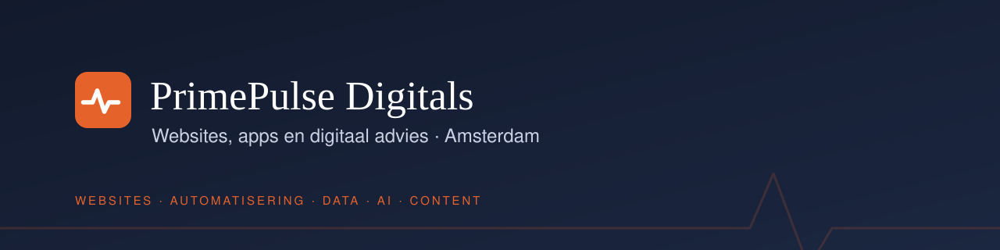

### Websites, apps and digital consultancy, based in Amsterdam.

PrimePulse Digitals builds websites and software, connects systems and automates recurring tasks for businesses and organisations. You work directly with the person who does the work.

**[Send an email](mailto:primepulsedigitals@gmail.com)** · **[View the portfolio](https://github.com/Primepulse-Digitals/portfolio)**

---

#### What PrimePulse does

| | What you get | Tools |
|---|---|---|
| **Websites & apps** | Websites, online shops and apps, from design and development to connections with your other systems | Next.js · React · Webflow · Framer · Shopify · Swift |
| **Automation & AI** | Recurring tasks handled automatically, such as transferring data, processing enquiries and drafting replies | n8n · Make · Zapier · OpenAI · Claude · Gemini |
| **Data & dashboards** | Data from spreadsheets and systems brought together in one dashboard, with the figures explained | Power BI · Python · pandas · PostgreSQL |
| **3D, video & content** | Photography, 3D product visuals and video for your website and campaigns | Blender · DaVinci Resolve · After Effects · Figma |
| **Custom software & integrations** | Connections between your systems and custom software for work your existing tools cannot handle | Python · Docker · Google Cloud · APIs |
| **Digital consultancy** | Help with software choices, planning, training and introducing new tools | |

#### How we work

1. **Introductory call**: you explain what you want to build or change and what you already use.
2. **Proposal**: you receive a proposal setting out the work, timeline and costs.
3. **Development**: you review work in progress and give feedback along the way.
4. **Handover**: you receive guidance and documentation. Maintenance and further work are agreed separately.

#### About these repositories

Client work is always kept in **private repositories**. Selected projects appear in the **[portfolio](https://github.com/Primepulse-Digitals/portfolio)** with the client's permission.

<b>Nederlands</b>

 

**Websites, apps en digitaal advies, vanuit Amsterdam.**

PrimePulse Digitals bouwt websites en software, koppelt systemen en automatiseert terugkerend werk voor ondernemers en organisaties. Je hebt direct contact met de persoon die het werk uitvoert.

Diensten: websites & apps · automatisering & AI · data & dashboards · 3D, video & content · maatwerk & integraties · digitaal advies.

Werkwijze: kennismaking → voorstel → uitwerking met tussentijdse versies → oplevering met documentatie.

[Stuur een e-mail](mailto:primepulsedigitals@gmail.com)

---

PrimePulse Digitals · Amsterdam, the Netherlands · Chamber of Commerce (KvK) 94484538
